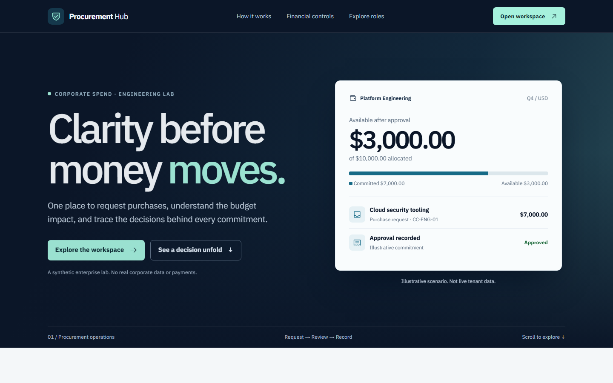
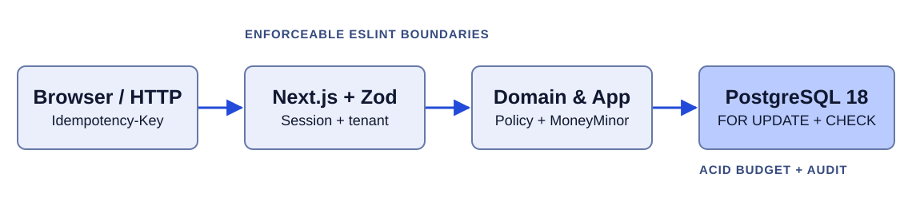

<div align="center">

<a href="#the-five-grok-bots"><picture>
  <source media="(prefers-reduced-motion: reduce)" srcset="slides/assets/bloub-cycle-still.webp">
  
</picture></a>

# GrokBot for Enterprise Engineering Workflows

### From Issue to Verified Pull Request

**Packt Advanced Workshop · December 11, 2026 · 60 minutes**

[](package.json)
[](tsconfig.json)
[](package.json)
[](compose.yaml)

[](vitest.config.ts)
[](playwright.config.ts)
[](formal/README.md)

Two approvers each see enough budget for a $7,000 purchase. What happens when they approve both requests at the same time against a shared $10,000 budget? In this workshop, you investigate that race in Procurement Hub, a synthetic purchasing app, and follow five Grok Bots from the first failing check to a pull request ready for human review.

**[Participant Guide](docs/workshop/PARTICIPANT-GUIDE.md) · [Facilitator Guide](docs/workshop/FACILITATOR-GUIDE.md) · [PH-42 Incident](doc-specs/03-demo-issue-42.md) · [Reusable Starter Kit](starter-kit/README.md) · [Slides](slides/README.md)**

</div>

## Table of Contents

- [Workshop pillars](#the-four-workshop-pillars) · [The PH-42 incident](#the-enterprise-incident-ph-42)
- [Application preview](#application-preview) · [Application architecture](#application-architecture) · [The five Grok Bots](#the-five-grok-bots)
- [Quick start](#quick-start) · [Engineering commands](#core-engineering-commands) · [Workshop editions and recovery](#workshop-editions-and-recovery)
- [Documentation and reusable assets](#workshop-resources) · [Attribution](#attribution) · [About the presenter](#about-the-presenter)

---

## The Four Workshop Pillars

| Pillar | What You Build & Verify | Key Artifacts |
| --- | --- | --- |
| **01 · Enforceable Architecture** | 4-layer Modular Monolith (`domain`, `application`, `infrastructure`, `app`) with executable ESLint import & monetary-safety rules, exact `MoneyMinor` types, Smart/Dumb Zone vertical slices, and ADRs | `eslint.config.ts`, `bun run verify:architecture`, `PRD.md`, `SPEC.md`, `docs/adr/` |
| **02 · Harness Engineering & Skills** | Isolated one-shot lifecycle harness (`launch -> doctor -> drive -> evidence -> cleanup`), portable `verify-procurement` skill, and 8 user-POV Feature Maps | `engineering/verify-lab.ts`, `skills/verify-procurement/SKILL.md`, `skills/verify-procurement/features/` |
| **03 · Runtime & Formal Verification** | Deterministic live PH-42 overspend reproduction (`$7k + $7k > $10k`), bounded Loop Engineering engine (`loop-runner.ts`), multi-connection concurrency & security suites, `fast-check` properties, Playwright E2E, and Dockerized TLA+/TLC model checking | `bun run ph42:reproduce`, `engineering/loop-runner.ts`, `tests/concurrency/`, `tests/security/`, `formal/ProcurementApproval.tla` |
| **04 · Evidence-Based Governance** | Exact-SHA machine (`manifest.json`) + human (`summary.md`) evidence bundles surviving cleanup, 6-job least-privilege CI with `governance-guard`, 11-section PR template, and explicit human merge accountability | `.github/workflows/workshop-verification.yml`, `.github/pull_request_template.md`, `docs/governance/ENTERPRISE-GOVERNANCE.md` |

---

## The Enterprise Incident: PH-42

**Procurement Hub** is a multi-tenant corporate procurement platform with Cost Center budgets, approval authority limits (`approvalLimitMinor`), financial commitments, idempotent workflows, and durable audit trails.

In **PH-42 (*Concurrent Procurement Approval Violates Financial and Tenant Isolation Invariants*)**:
- Northstar Cost Center `CC-ENG-01` has an **Allocated Budget** of **`$10,000.00`**.
- Two `PENDING` purchase requests require **`$7,000.00`** each.
- On `workshop/starter`, approving both concurrently commits **`$14,000.00`** against **`$10,000.00`** (**`-$4,000.00` available**), violating `INV-01` and `INV-02`.
- The reference solution (`workshop/solution`) enforces all ten business invariants (`INV-01`–`INV-10`) through PostgreSQL row-level locking (`SELECT ... FOR UPDATE`), database `CHECK` and `UNIQUE` constraints, tenant-scoped `decision_idempotency_keys` with canonical payload conflict detection, authorization re-checked before idempotent replay, and atomic ACID audit trails.

## Application Preview



*The public home introduces the decision workflow with an example $7,000 commitment.*


*Northstar has $28,000 available across two cost centers. The selected CI Runner Capacity Expansion request would exceed the $3,000 available in Platform Engineering.*


*The request records who submitted and approved it. The commitment panel identifies the approver and the amount posted.*

## Application Architecture

Procurement Hub is a **modular monolith**. When an approver submits a decision, a Next.js route validates the input with Zod. The server uses the session and membership record to identify the approver, their tenant and their approval limit. The application layer calls a repository interface, and the domain defines approval rules and represents money in integer cents. For a successful approval, the PostgreSQL adapter updates the request and its cost center, records the financial commitment, and appends the audit event in one transaction. [Architecture and API contracts](SPEC.md)



## The Five Grok Bots

| Bot | What it contributes to PH-42 |
| --- | --- |
| **PH Lead** | Sets the acceptance criteria with Glau and assigns the investigation to PH Engineer. |
| **PH Engineer** | Uses the failing run to identify the cause and prepares the TypeScript patch. |
| **PH Quality** | Checks the candidate independently. For the two $7,000 requests, it compares the API responses with the database and looks for one commitment and $3,000 left. |
| **PH Security** | Reviews the same commit for tenant isolation and approval limits, including whether a retry still requires authorization. |
| **PH Platform** | Prepares the lab and assembles the verification results for review, identifying the exact Git commit tested. |

Glau runs the checks in the local lab and shares sanitized results with the bots. Quality and Security return findings to Engineer. Glau reviews the evidence and decides whether to merge. [Team roles and review protocol](docs/agents/AGENT-ROLES.md)

---

## Quick Start

**Prerequisites:** [Bun 1.4.5](https://bun.sh/), Docker Compose v2, and Git. (**No host Java required** — `verify:formal` automatically uses a pinned Docker JRE container if local `java` is absent.)

```bash
cp .env.example .env            # Windows PowerShell: Copy-Item .env.example .env
bun install --frozen-lockfile
bun run browser:install
bun run lab:bootstrap
bun run dev                     # Terminal 2: http://127.0.0.1:3000
```

The selected workspace design is the default in both development and production. Open
[`/home`](http://localhost:3000/home) for the product introduction and choose a synthetic
lab identity to enter [`/dashboard`](http://localhost:3000/dashboard). The root `/` shows
the product home before identity selection and the workspace afterwards. No design
selector, variant query parameter, or prototype environment flag is needed.

Requesters submit purchases from **New purchase request**. Approvers select a request
in the inbox, review its financial impact, and use **Record decision** to save an
approval or rejection through the existing API. The scrolling phone on the home page
is explicitly illustrative; workspace requests, decisions, budgets, and audit events
come from the lab database.

### Core Engineering Commands

| Goal | Command |
| --- | --- |
| Check database & app readiness | `bun run lab:doctor` |
| Static types + ESLint | `bun run check:static` |
| Prove architectural boundaries reject violations | `bun run verify:architecture` |
| Seed `$10,000` `CC-ENG-01` + `$7k/$7k` browser demo | `bun run lab:seed:ph42` |
| Reproduce PH-42 concurrent approval live | `bun run ph42:reproduce` |
| Run Vitest unit, integration, concurrency, security, properties, harness | `bun run test:unit` · `test:integration` · `test:concurrency` · `test:security` · `test:properties` · `test:harness` |
| Run Playwright Chromium E2E tests | `bun run test:e2e` |
| Run bounded TLA+ / TLC model checking (zero host Java) | `bun run verify:formal` |
| Run complete isolated verification harness (`manifest.json` + `summary.md`) | `bun run verify:all --slice solution --run-id rehearsal` |
| Build & verify Reveal.js slides | `bun run slides:verify` |

---

## Workshop editions and recovery

Branch names below identify refs inside individual bundles. Availability depends on the bundle supplied for the session. Check its manifest and clone HEAD before use.

| Ref | Purpose |
| --- | --- |
| `workshop/starter` | Spoiler-free runnable brownfield app with the real reproducible PH-42 overspending defect (`ph42:reproduce` exits `1`) |
| `workshop/guided` | Starter + progressive `GUIDED-WORKSHEET.md` hints and milestones without revealing the full fix |
| `workshop/solution` | Complete verified reference implementation, tests, formal verification, and governance artifacts |
| `checkpoint-00-starter` .. `checkpoint-05-pr-ready` | Historical local refs. Use a verified bundle and its manifest to recover the current UI |

---

<a name="workshop-resources"></a>

## Documentation & Reusable Enterprise Assets

- **Hands-on Labs:** [Participant Replication Guide](docs/workshop/PARTICIPANT-GUIDE.md) · [Facilitator Runbook](docs/workshop/FACILITATOR-GUIDE.md)
- **Reusable Starter Kit (12 templates + brownfield guide):** [starter-kit/README.md](starter-kit/README.md)
- **Specifications & Architecture:** [PRD.md](PRD.md) · [SPEC.md](SPEC.md) · [Glossary](docs/domain/GLOSSARY.md) · [Traceability Matrix](docs/architecture/REQUIREMENTS-TRACEABILITY.md) · [Vertical Slices](docs/architecture/VERTICAL-SLICES.md) · [ADRs](docs/adr/)
- **Assessment & Attribution:** [Enterprise Gap Analysis](docs/assessment/ENTERPRISE-GAP-ANALYSIS.md) · [Lauren Tan / pstack Source Traceability](docs/architecture/SOURCE-TRACEABILITY.md) · [Skill Inventory](docs/architecture/SKILL-INVENTORY.md)
- **Workflows & Governance:** [Loop Engineering](docs/workflows/LOOP-ENGINEERING.md) · [Specialized Agent Roles](docs/agents/AGENT-ROLES.md) · [Enterprise Governance](docs/governance/ENTERPRISE-GOVERNANCE.md)

---

## Attribution

The black PH Security avatar uses Bloub by Jérémy Perret. [Artwork credits](slides/assets/credits.txt) · [Bloub license](slides/assets/bloub-license.txt)

Inspired by Lauren Tan's [*All Code Is Slop (Except Mine)*](https://www.youtube.com/watch?v=O_zcc6Xl12g) and [`cursor/plugins/pstack`](https://github.com/cursor/plugins/tree/main/pstack) (MIT). All skills, harnesses, loop runners, and formal workflows in this repository are independent, portable TypeScript adaptations for this workshop.

---

## About the Presenter

<div align="center">
  <a href="https://github.com/glaucia86"></a>
  <h3>Glaucia Lemos</h3>
  <p>Principal Software Engineer · Developer Educator · OpenAI Codex Ambassador</p>
  <p><a href="https://github.com/glaucia86">GitHub</a> · <a href="https://www.linkedin.com/in/glaucialemos/">LinkedIn</a> · <a href="https://www.youtube.com/user/l32759">YouTube</a></p>
</div>
