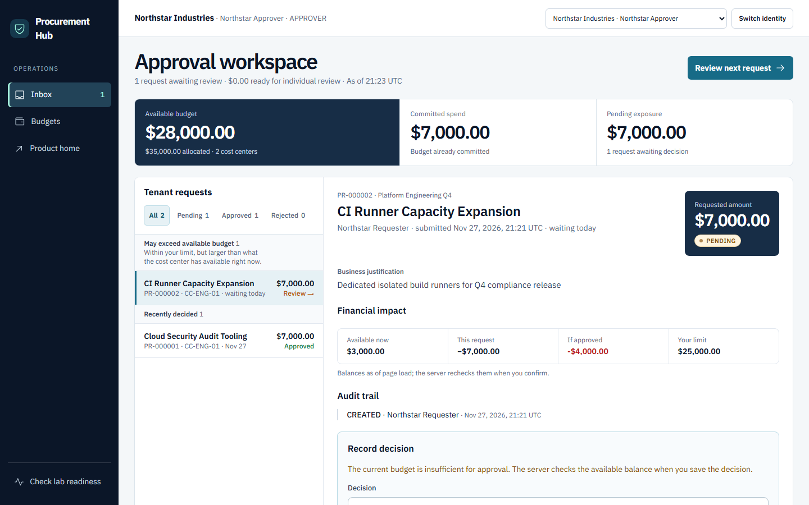
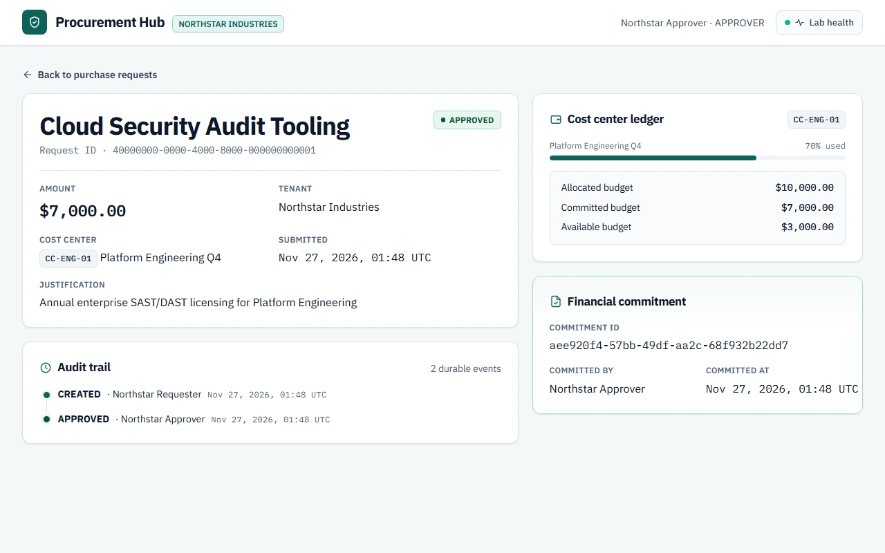

<div align="center">

# GrokBot for Enterprise Engineering Workflows

### From Issue to Verified Pull Request

**Packt Advanced Workshop · December 11, 2026 · 60 minutes**

[](https://www.typescriptlang.org/)
[](https://bun.sh/)
[](https://nextjs.org/)
[](https://www.postgresql.org/)
[](https://vitest.dev/)
[](https://playwright.dev/)
[](formal/README.md)

Build an enterprise engineering environment where AI coding agents autonomously investigate, fix, and verify a real financial concurrency incident under enforceable architectural constraints and human-approved delivery governance.

**[Participant Guide](docs/workshop/PARTICIPANT-GUIDE.md) · [Facilitator Guide](docs/workshop/FACILITATOR-GUIDE.md) · [PH-42 Incident](doc-specs/03-demo-issue-42.md) · [Reusable Starter Kit](starter-kit/README.md) · [Slides](slides/README.md)**

</div>

---

## The Four Workshop Pillars

| Pillar | What You Build & Verify | Key Artifacts |
| --- | --- | --- |
| **01 · Enforceable Architecture** | 4-layer Modular Monolith (`domain`, `application`, `infrastructure`, `app`) with executable ESLint import & monetary-safety rules, exact `MoneyMinor` types, Smart/Dumb Zone vertical slices, and ADRs | `eslint.config.ts`, `bun run verify:architecture`, `PRD.md`, `SPEC.md`, `docs/adr/` |
| **02 · Harness Engineering & Skills** | Isolated one-shot lifecycle harness (`launch -> doctor -> drive -> evidence -> cleanup`), portable `verify-procurement` skill, and 8 user-POV Feature Maps | `engineering/verify-lab.ts`, `skills/verify-procurement/SKILL.md`, `skills/verify-procurement/features/` |
| **03 · Runtime & Formal Verification** | Deterministic live PH-42 overspend reproduction (`$7k + $7k > $10k`), bounded Loop Engineering engine (`loop-runner.ts`), multi-connection concurrency & security suites, `fast-check` properties, Playwright E2E, and Dockerized TLA+/TLC model checking | `bun run ph42:reproduce`, `engineering/loop-runner.ts`, `tests/concurrency/`, `tests/security/`, `formal/ProcurementApproval.tla` |
| **04 · Evidence-Based Governance** | Exact-SHA machine (`manifest.json`) + human (`summary.md`) evidence bundles surviving cleanup, 6-job least-privilege CI with `governance-guard`, 11-section PR template, and explicit human merge accountability | `.github/workflows/workshop-verification.yml`, `.github/pull_request_template.md`, `docs/governance/ENTERPRISE-GOVERNANCE.md` |

---

## The Enterprise Incident: PH-42

**Procurement Hub** is a multi-tenant corporate procurement platform with Cost Center budgets, approval authority limits (`approvalLimitMinor`), financial commitments, idempotent workflows, and durable audit trails.

In **PH-42 (*Concurrent Procurement Approval Violates Financial and Tenant Isolation Invariants*)**:
- Northstar Cost Center `CC-ENG-01` has an **Allocated Budget** of **`$10,000.00`**.
- Two `PENDING` purchase requests require **`$7,000.00`** each.
- On `workshop/starter`, approving both concurrently commits **`$14,000.00`** against **`$10,000.00`** (**`-$4,000.00` available**), violating `INV-01` and `INV-02`.
- The reference solution (`workshop/solution`) enforces all ten business invariants (`INV-01`–`INV-10`) through PostgreSQL row-level locking (`SELECT ... FOR UPDATE`), database `CHECK` and `UNIQUE` constraints, tenant-scoped `decision_idempotency_keys` with canonical payload conflict detection, authorization re-checked before idempotent replay, and atomic ACID audit trails.

### Application Preview



*Enterprise dashboard: Cost Center ledger (`CC-ENG-01` at 70% utilization after approving `$7,000.00`), KPI summary strip, approval limit badge, and URL-synced status filters.*



*Request detail view: 2-column executive layout with Cost Center ledger, durable 1:1 financial commitment record, and chronological vertical audit trail.*

---

## Quick Start

**Prerequisites:** [Bun 1.4.5](https://bun.sh/), Docker Compose v2, and Git. (**No host Java required** — `verify:formal` automatically uses a pinned Docker JRE container if local `java` is absent.)

```bash
cp .env.example .env            # Windows PowerShell: Copy-Item .env.example .env
bun install --frozen-lockfile
bun run browser:install
bun run lab:bootstrap
bun run dev                     # Terminal 2: http://127.0.0.1:3000
```

### Core Engineering Commands

| Goal | Command |
| --- | --- |
| Check database & app readiness | `bun run lab:doctor` |
| Static types + ESLint | `bun run check:static` |
| Prove architectural boundaries reject violations | `bun run verify:architecture` |
| Seed `$10,000` `CC-ENG-01` + `$7k/$7k` browser demo | `bun run lab:seed:ph42` |
| Reproduce PH-42 concurrent approval live | `bun run ph42:reproduce` |
| Run Vitest unit, integration, concurrency, security, properties, harness | `bun run test:unit` · `test:integration` · `test:concurrency` · `test:security` · `test:properties` · `test:harness` |
| Run Playwright Chromium E2E tests | `bun run test:e2e` |
| Run bounded TLA+ / TLC model checking (zero host Java) | `bun run verify:formal` |
| Run complete isolated verification harness (`manifest.json` + `summary.md`) | `bun run verify:all --slice solution --run-id rehearsal` |
| Build & verify Reveal.js slides | `bun run slides:verify` |

---

## Workshop Branches & Recovery Checkpoints

| Ref | Purpose |
| --- | --- |
| `workshop/starter` | Spoiler-free runnable brownfield app with the real reproducible PH-42 overspending defect (`ph42:reproduce` exits `1`) |
| `workshop/guided` | Starter + progressive `GUIDED-WORKSHEET.md` hints and milestones without revealing the full fix |
| `workshop/solution` | Complete verified reference implementation, tests, formal verification, and governance artifacts |
| `checkpoint-00-starter` .. `checkpoint-05-pr-ready` | Immutable local recovery checkpoints for live 60-minute facilitation |

---

## Documentation & Reusable Enterprise Assets

- **Hands-on Labs:** [Participant Replication Guide](docs/workshop/PARTICIPANT-GUIDE.md) · [Facilitator Runbook](docs/workshop/FACILITATOR-GUIDE.md)
- **Reusable Starter Kit (12 templates + brownfield guide):** [starter-kit/README.md](starter-kit/README.md)
- **Specifications & Architecture:** [PRD.md](PRD.md) · [SPEC.md](SPEC.md) · [Glossary](docs/domain/GLOSSARY.md) · [Traceability Matrix](docs/architecture/REQUIREMENTS-TRACEABILITY.md) · [Vertical Slices](docs/architecture/VERTICAL-SLICES.md) · [ADRs](docs/adr/)
- **Assessment & Attribution:** [Enterprise Gap Analysis](docs/assessment/ENTERPRISE-GAP-ANALYSIS.md) · [Lauren Tan / pstack Source Traceability](docs/architecture/SOURCE-TRACEABILITY.md) · [Skill Inventory](docs/architecture/SKILL-INVENTORY.md)
- **Workflows & Governance:** [Loop Engineering](docs/workflows/LOOP-ENGINEERING.md) · [Specialized Agent Roles](docs/agents/AGENT-ROLES.md) · [Enterprise Governance](docs/governance/ENTERPRISE-GOVERNANCE.md)

---

## Attribution

Inspired by Lauren Tan's [*All Code Is Slop (Except Mine)*](https://www.youtube.com/watch?v=O_zcc6Xl12g) and [`cursor/plugins/pstack`](https://github.com/cursor/plugins/tree/main/pstack) (MIT). All skills, harnesses, loop runners, and formal workflows in this repository are independent, portable TypeScript adaptations for this workshop.

---

## About the Presenter

<div align="center">
  <a href="https://github.com/glaucia86"></a>
  <h3>Glaucia Lemos</h3>
  <p>Principal Software Engineer · Developer Educator · OpenAI Codex Ambassador</p>
  <p><a href="https://github.com/glaucia86">GitHub</a> · <a href="https://www.linkedin.com/in/glaucialemos/">LinkedIn</a> · <a href="https://www.youtube.com/user/l32759">YouTube</a></p>
</div>
