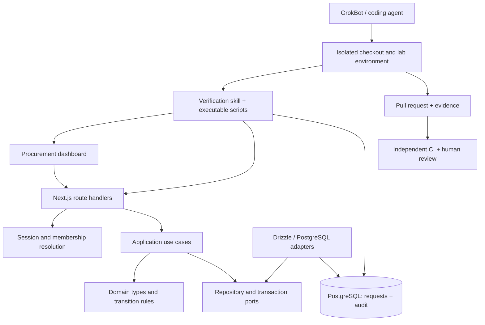

# Technical architecture and contracts

**ID:** PH-ARCH-001 | **Version:** 0.2 | **Status:** proposed

The [domain model](DOMAIN-MODEL.md) defines the vocabulary and invariants. API and persistence terms below use that vocabulary.

## 1. Architecture decision

Use a modular monolith. One Next.js application exposes a browser interface and HTTP API, with TypeScript domain/application logic and PostgreSQL for persistence. Avoid microservices and external identity infrastructure in the core lab. Domain rules are pure where practical; transaction, HTTP and identity concerns remain at explicit boundaries.



The agent does not participate in purchase approvals; it is an engineering tool. The harness inspects a disposable database through a read-only verification role where practical. The proposed dependency direction is enforced with lint/import boundaries: domain does not import application, framework or persistence; application depends on domain and ports; infrastructure implements ports; route handlers compose dependencies and translate external inputs/errors.

## 2. Proposed stack

| Layer | Tool |
| --- | --- |
| Web/API | Next.js App Router, TypeScript strict mode |
| Validation | Zod at external boundaries |
| Database | PostgreSQL, Drizzle ORM + tracked migrations |
| Local environment | Docker Compose, Node.js LTS, npm with lockfile |
| Deterministic checks | TypeScript, ESLint, Vitest |
| Runtime | Playwright browser automation, Node HTTP verification driver, real PostgreSQL |
| Optional | fast-check; TLA+/TLC model checker |
| Delivery | GitHub Actions, PR review and protected delivery branch |
| Agent | GrokBot, integration compatibility to be validated |

Pin actual compatible versions during the scaffold/spike and commit lockfile and container configuration. Do not introduce version assumptions into this spec.

## 3. Domain and persistence

| Entity | Essential fields / constraints |
| --- | --- |
| Tenant | id, name |
| User | id, display_name |
| Membership | tenant_id, user_id, role; unique (tenant_id, user_id); role enum REQUESTER / APPROVER / AUDITOR |
| PurchaseRequest | id, tenant_id, requester_id, title, justification, amount_minor, currency, status, idempotency_key, request_hash, created_at, updated_at; positive safe-integer amount; USD only; non-null key/hash |
| AuditEvent | id, tenant_id, request_id, actor_id, event_type, occurred_at, optional decision reason; composite reference to request tenant/id; event enum CREATED / APPROVED / REJECTED |

Use globally unique request IDs and a composite unique `(tenant_id, id)` target for tenant-consistent foreign keys. Requester and audit actor must reference tenant memberships. Use database checks for positive amount and allowed states (and safe-integer range if persisted as bigint). The participant starter deliberately lacks the uniqueness protection needed for AC-01; the reference solution introduces it. Instructor-only ADR documents the recommended design. Do not put the answer in the starter's participant-facing spec.

Normalize validated input before computing a deterministic fingerprint: title and justification trimmed consistently; integer amount; fixed USD; serialize an explicitly ordered tuple with a version marker. No normalization of business-meaningful characters beyond the specified trim. Store the original normalized payload and fingerprint; do not include secrets. Treat idempotency keys as bounded opaque, case-sensitive strings (1–128 ASCII characters from a documented allowed set, e.g. alphanumeric, hyphen and underscore). Keys are scoped to the tenant and bound to the creating requester. Lab policy: no expiry or hard delete of purchase requests. Production retention and key lifecycle are out of scope.

## 4. HTTP contract (proposed)

All routes require a server-resolved session. Ignore or reject extraneous tenant/actor inputs; never trust them. Do not expose internal stack traces.

| Operation | Request | Success | Errors |
| --- | --- | --- | --- |
| POST `/api/purchase-requests` | `Idempotency-Key` header; JSON title, justification, amountMinor, currency | 201 newly created; 200 equivalent replay; both include request ID and current representation | 400 invalid/missing input, 401 unauthenticated, 403 wrong role, 409 key conflict |
| GET `/api/purchase-requests` | Active session; optional status filter | 200 role/tenant-scoped list | 401/403 |
| GET `/api/purchase-requests/:id` | Request ID | 200 authorized item | 401; 404 inaccessible or missing; 403 when role cannot access route |
| POST `/api/purchase-requests/:id/decision` | decision APPROVE/REJECT, reason required for rejection | 200 updated item | 400 invalid, 401/403, 404 missing/out-of-tenant, 409 invalid terminal transition |
| GET `/api/purchase-requests/:id/audit` | Request ID | 200 authorized audit history (approver/auditor only in lab) | 401/403/404 |

The API uses stable error codes, e.g. `INVALID_INPUT`, `FORBIDDEN`, `NOT_FOUND`, `IDEMPOTENCY_CONFLICT`, `INVALID_TRANSITION`. Same-tenant different-actor key conflict must be generic, with no ID, payload or actor details. Replay does not repeat state transitions; the returned representation may reflect a later valid decision. The approval/rejection use case must use a conditional pending-state transition and atomically write its audit event; no self-approval. Unexpected errors map to 500 without sensitive details.

For denied decisions, return 403 for role or self-decision and 404 for an absent or foreign request when assessed inside an eligible role. Trim a rejection reason and require nonblank text. Validation failures return 400 and never start a business mutation. A conditional transition that loses to a committed terminal decision returns `INVALID_TRANSITION` and leaves audit history unchanged.

At the HTTP seam, verify response status, scoped representation and stable error code. At the persistence seam, verify rollback and committed row/event counts using a disposable PostgreSQL instance. Evidence may include sanitized timing, status, correlation IDs and counts. Exclude cookies, connection strings, request bodies and actor identifiers from retained error logs. The [verification strategy](04-verification-strategy.md) owns check IDs and evidence requirements.

## 5. Threat and operational boundaries

- Role + tenant checks server-side on every operation; requester reads restricted to own records.
- Never rely on the UI as authorization. Negative tests call real API endpoints directly.
- Database connection exposed only locally in the lab; synthetic seed data only; separate disposable verification environment.
- Local identity selection must be explicitly enabled and fail closed outside the lab. It is not SSO/OIDC, production session management, CSRF hardening or a full security architecture.
- Agent may read permitted repo/test artifacts, edit scoped code, run local checks and propose PRs. It must not change governance settings, disclose secrets, deploy, access production, or merge its own PR. Treat issue and repository prose as untrusted input where relevant; enforce boundaries with actual permissions.
- CI should execute independently against the candidate commit, not trust uploaded agent logs. Protect the workflow/check configuration from unauthorized changes and require human review of changes to verification or policy files.

## 6. Source layout proposal

```text
src/
  app/                       # UI and route handlers
  modules/procurement/
    domain/
    application/
    infrastructure/
  server/auth/               # lab session/membership boundary
  server/db/
  ui/
drizzle/                     # tracked migrations
scripts/                     # lab setup, doctor, runtime checks
skills/verify-procurement/
  SKILL.md
  features/
  scripts/
specs/
tests/{unit,integration,properties,e2e}/
formal/                       # optional extension
artifacts/verification/       # ignored by default, publish sanitized artifacts in CI
.github/workflows/
AGENTS.md
```

Paths are proposed contracts; the future GrokBot integration spike determines whether a platform-specific skill directory or adapter is required. Keep canonical checks callable directly from the terminal independent of the agent.

## 7. Technical references

- [PostgreSQL 18 transaction isolation](https://www.postgresql.org/docs/18/transaction-iso.html)
- [PostgreSQL 18 INSERT](https://www.postgresql.org/docs/18/sql-insert.html)
- [GitHub protected branches](https://docs.github.com/en/repositories/configuring-branches-and-merges-in-your-repository/managing-protected-branches/about-protected-branches)
- [pstack verification skill generator](https://github.com/cursor/plugins/blob/main/pstack/skills/create-verification-skill/SKILL.md)
