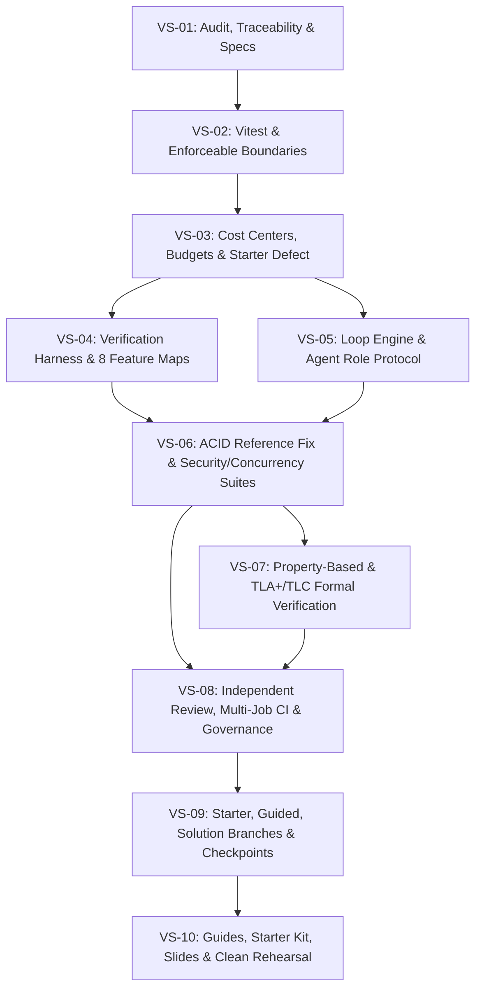

# Vertical Slices, Dependency DAG & Smart/Dumb Zone Classification

Applied from `.agents/skills/to-tickets/SKILL.md` and `.agents/skills/implement-spec/SKILL.md`: every slice cuts a narrow, independently verifiable **vertical path** from domain/persistence through API/UI/verification. Horizontal layer-only slices are prohibited.

---

## 1. Smart Zone vs. Dumb Zone Classification

Enterprise agentic workflows succeed when teams separate deterministic execution (**Dumb Zone**) from high-judgment engineering (**Smart Zone**):

| Classification | Characteristics | Governance & Agent Autonomy |
| --- | --- | --- |
| **Dumb Zone** | Unambiguous spec, fixed contracts, mechanical wiring, predictable schemas/UI/scaffolding, clear pass/fail checks. | High agent autonomy inside bounded loop; deterministic static/unit/E2E gates catch mistakes cheaply. |
| **Smart Zone** | Concurrency reasoning, transaction isolation & locking trade-offs, security & authorization invariants, formal modeling, root-cause diagnosis, interpreting counterexamples, release governance. | Explicit ADR/hypothesis required before code changes; adversarial QA + Security + formal verification + human review mandatory. |

---

## 2. Dependency Graph (DAG)

---

## 3. Vertical Slice Contracts

### VS-01 — Forensic Audit, Traceability & Enterprise Specification
- **Zone:** **Smart Zone** (architectural judgment, domain redesign, trade-off analysis)
- **Dependencies:** None (starts from `main` @ `d0b0226`)
- **Requirements / Invariants:** `INV-01`–`INV-10`, Golden Prompt §§3–4, 7–8, 13
- **Acceptance Criteria:** 16-dimension gap analysis complete; Lauren Tan / `pstack` traceability explicit; `PRD.md`, `SPEC.md`, `GLOSSARY.md`, `RTM`, `DoD`, `ADR-0001..0005`, and spoiler-free PH-42 issue consistent and cross-linked.
- **Expected Artifacts:** `docs/assessment/ENTERPRISE-GAP-ANALYSIS.md`, `docs/architecture/SOURCE-TRACEABILITY.md`, `PRD.md`, `SPEC.md`, `docs/domain/GLOSSARY.md`, `docs/adr/ADR-0001..0005.md`, `doc-specs/03-demo-issue-42.md`.
- **Verification Commands:** `bun engineering/verify-specifications.ts` (link & doc integrity review).
- **Exit Criteria:** All docs present, zero broken internal links, all 10 invariants traceable.
- **Handoff:** Record phase summary in `docs/assessment/TRANSFORMATION-LOG.md` and hand off to VS-02.

### VS-02 — Vitest Adoption & Four-Layer Enforceable Architecture
- **Zone:** **Dumb Zone** (mechanical test runner migration) + **Smart Zone** (ESLint boundary rule design)
- **Dependencies:** `VS-01`
- **Requirements / Invariants:** `AC-10`, Pillar 01, Trust Pyramid Layers 1–2
- **Acceptance Criteria:** Pinned Vitest configured (`vitest.config.ts`); ESLint rejects forbidden imports in `domain`, `application`, `infrastructure`, and `src/app/**/*.tsx`; negative architecture fixtures prove rejection.
- **Expected Artifacts:** `vitest.config.ts`, updated `eslint.config.ts`, `tests/unit/architecture.test.ts`, `scripts/verify-architecture.ts`.
- **Verification Commands:** `bun run check:static`, `bun run verify:architecture`, `bun run test:unit`.
- **Exit Criteria:** All static and negative boundary tests pass (`exit 0`).
- **Handoff:** Pass verified commit SHA and boundary command results to VS-03.

### VS-03 — Cost Centers, Budgets, Commitments & Reproducible Starter Defect
- **Zone:** **Smart Zone** (financial domain modeling & deterministic race reproduction design)
- **Dependencies:** `VS-02`
- **Requirements / Invariants:** `FR-01`–`FR-05`, `INV-01`, `INV-02`, starter defect reproducibility
- **Acceptance Criteria:** Migration `0002` + updated seed (`CC-ENG-01` `$10,000`, `CC-OPS-01` `$25,000`, `CC-MER-01` `$10,000`, 9 synthetic identities); UI & API expose Cost Centers & budgets; normal sequential workflow passes; `bun run ph42:reproduce` deterministically fails on starter showing `$14,000` committed vs `$10,000` allocated (`-$4,000` available).
- **Expected Artifacts:** `drizzle/0002_cost_centers_and_commitments.sql`, `src/modules/procurement/**`, `src/app/**`, `scripts/seed-lab.sql`, `scripts/reproduce-ph42.ts`.
- **Verification Commands:** `bun run lab:up`, `bun run lab:doctor`, `bun run ph42:reproduce` (expected exit `1` on defective baseline), `bun run check:static`.
- **Exit Criteria:** Normal baseline green; live PH-42 overspending deterministically observed in real PostgreSQL.
- **Handoff:** Capture exact starter commit/patch for `workshop/starter` packaging before applying the VS-06 reference fix.

### VS-04 — Verification Harness & Eight Actionable Feature Maps
- **Zone:** **Dumb Zone** (CLI wiring & manifests) + **Smart Zone** (proof standards & feature map design)
- **Dependencies:** `VS-03`
- **Requirements / Invariants:** `FR-09`, `AC-12`, Pillar 02, Trust Pyramid Layer 3
- **Acceptance Criteria:** `verify:all` drives `launch -> doctor -> drive -> evidence -> cleanup`, writes both `manifest.json` and `summary.md` + DB snapshots + screenshots surviving cleanup; `skills/verify-procurement/SKILL.md` and all 8 feature maps completed and exercised.
- **Expected Artifacts:** `engineering/verify-lab.ts`, `skills/verify-procurement/SKILL.md`, 8 files in `skills/verify-procurement/features/`, updated `package.json` scripts.
- **Verification Commands:** `bun run test:harness`, `bun run verify:all --run-id vs04-check`.
- **Exit Criteria:** Evidence bundle exists and validates after cleanup destroys temporary DB and app process.
- **Handoff:** Provide verified harness entry points to VS-06.

### VS-05 — Bounded Loop Engine & Specialized Agent Collaboration
- **Zone:** **Smart Zone** (loop control, anti-spin hypothesis guard, role separation)
- **Dependencies:** `VS-03`
- **Requirements / Invariants:** Golden Prompt §§14–15
- **Acceptance Criteria:** `engineering/loop-runner.ts` enforces iteration/time/consecutive-failure/scope budgets, refuses duplicate failing runs without new hypothesis or diff, and persists `state.json` + `handoff.md`; `docs/agents/AGENT-ROLES.md` documents all 6 roles & sequential fresh-context handoff protocol.
- **Expected Artifacts:** `engineering/loop-runner.ts`, `docs/workflows/LOOP-ENGINEERING.md`, `docs/agents/AGENT-ROLES.md`, `tests/unit/loop-runner.test.ts`.
- **Verification Commands:** `bun run test:harness`, `bun run loop:status`.
- **Exit Criteria:** Loop invariants verified by automated unit tests and dry run.
- **Handoff:** Loop engine ready for live demo & Phase 06 verification.

### VS-06 — Reference ACID Solution, Concurrency, Security & Browser Verification
- **Zone:** **Smart Zone** (PostgreSQL locking, idempotency replay, auth-on-replay, rollback safety)
- **Dependencies:** `VS-04`, `VS-05`
- **Requirements / Invariants:** `INV-01`–`INV-10`, `AC-01`–`AC-09`
- **Acceptance Criteria:** Migration `0003` upgrades clean DBs and refuses overspent/duplicate legacy DBs; `decide()` uses `FOR UPDATE` + `CHECK` + `financial_commitments` + `decision_idempotency_keys` + auth-before-replay; `ph42:reproduce` turns GREEN (`exit 0`, `$7k <= $10k`); full integration, concurrency, security, and Playwright E2E suites pass.
- **Expected Artifacts:** `drizzle/0003_approval_integrity_constraints.sql`, `src/modules/procurement/infrastructure/postgres-requests.ts`, `tests/integration/**`, `tests/concurrency/**`, `tests/security/**`, `tests/e2e/**`.
- **Verification Commands:** `bun run ph42:reproduce`, `bun run test:integration`, `bun run test:concurrency`, `bun run test:security`, `bun run test:e2e`.
- **Exit Criteria:** Every `AC-01`–`AC-09` passes against real PostgreSQL 18 and Chromium.
- **Handoff:** Pass verified solution SHA to VS-07 & VS-08.

### VS-07 — Property-Based Testing & Bounded TLA+ / TLC Formal Verification
- **Zone:** **Smart Zone** (formal specification, invariant formulation, counterexample interpretation)
- **Dependencies:** `VS-06`
- **Requirements / Invariants:** `AC-08`, `AC-11`, Trust Pyramid Layer 4
- **Acceptance Criteria:** `fast-check` suite tests budgets, amounts, operation sequences, retries, state transitions, and tenants with pinned seed; `formal/ProcurementApproval.tla` executes via real TLC (native Java or Docker JRE fallback) producing exit-12 counterexample (`defective-read-commit.cfg`) and exit-0 exhaustive pass (`locked-atomic.cfg`); `skills/verify-formal-approval/SKILL.md` validated.
- **Expected Artifacts:** `tests/properties/procurement.properties.test.ts`, `formal/ProcurementApproval.tla`, `formal/*.cfg`, `formal/README.md`, `engineering/verify-formal.ts`, `skills/verify-formal-approval/SKILL.md`.
- **Verification Commands:** `bun run test:properties`, `bun run verify:formal`.
- **Exit Criteria:** Counterexample trace and exhaustive pass archived under `artifacts/formal/<run-id>/`.
- **Handoff:** Link formal evidence hash and bounds to VS-08.

### VS-08 — Independent Code/Security Review, Multi-Job CI & Governance
- **Zone:** **Smart Zone** (security review, governance guard, least-privilege CI)
- **Dependencies:** `VS-06`, `VS-07`
- **Requirements / Invariants:** `AC-12`, Pillar 04
- **Acceptance Criteria:** `clean-code`, `code-review-and-quality`, and security checklist findings resolved; `.github/workflows/workshop-verification.yml` runs 6 independent least-privilege jobs including `governance-guard`; `.github/pull_request_template.md` includes all 11 enterprise sections; `docs/governance/ENTERPRISE-GOVERNANCE.md` separates workflow config from repo admin branch protection.
- **Expected Artifacts:** `.github/workflows/workshop-verification.yml`, `.github/pull_request_template.md`, `docs/governance/ENTERPRISE-GOVERNANCE.md`.
- **Verification Commands:** Full local execution of all CI job commands + `bun run verify:all`.
- **Exit Criteria:** Clean-tree `verify:all` passes (`exit 0`) with sanitized evidence manifest.
- **Handoff:** Ready for branch packaging in VS-09.

### VS-09 — Starter, Guided & Solution Branches + Recovery Checkpoints
- **Zone:** **Smart Zone** (history hygiene, zero-spoiler isolation)
- **Dependencies:** `VS-08`
- **Requirements / Invariants:** Golden Prompt §18
- **Acceptance Criteria:** Local `workshop/starter`, `workshop/guided`, and `workshop/solution` branches plus 6 recovery checkpoint tags (`checkpoint-00-starter`..`checkpoint-05-pr-ready`) created cleanly; `starter` has zero solution leaks and reproduces PH-42 live (`exit 1`); `guided` has progressive hints without full fix; `solution` passes all checks (`exit 0`).
- **Expected Artifacts:** Updated `engineering/package-workshop.ts`, local branches and tags, `release/starter.patch`, `release/guided.patch`.
- **Verification Commands:** Clean clone rehearsal of each branch in temp directories.
- **Exit Criteria:** All three branches independently verified from fresh clones.
- **Handoff:** Freeze verified refs for VS-10 documentation & slides.

### VS-10 — Guides, Reusable Enterprise Starter Kit, Slides & Final Rehearsal
- **Zone:** **Dumb Zone** (templates) + **Smart Zone** (curriculum design, 60-min timing, claim-to-evidence alignment)
- **Dependencies:** `VS-09`
- **Requirements / Invariants:** Golden Prompt §§19–23, 25–26
- **Acceptance Criteria:** `docs/workshop/PARTICIPANT-GUIDE.md` (23 sections), `docs/workshop/FACILITATOR-GUIDE.md` (60-min live schedule), `starter-kit/` (12 templates + brownfield guide), and aligned `slides/` (EN slides + EN/PT-BR speaker notes) verified via `bun run slides:verify` and full clean-checkout rehearsal.
- **Expected Artifacts:** `docs/workshop/*.md`, `starter-kit/**`, `slides/**`, updated `README.md` & `AGENTS.md`, final 15-section delivery report.
- **Verification Commands:** `bun run slides:verify`, `bun run verify:all`, `bun run verify:formal`, clean-checkout participant walkthrough.
- **Exit Criteria:** Definition of Done satisfied; every capability honestly classified.
